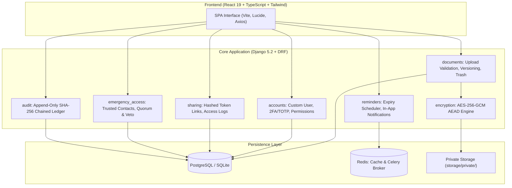

# LifeVault: Secure Digital Document & Personal Records Vault

[](https://www.python.org/)
[](https://www.djangoproject.com/)
[](https://react.dev/)
[](https://www.typescriptlang.org/)
[](https://tailwindcss.com/)
[](LICENSE)
[](#automated-testing)

LifeVault is a high-assurance, defense-in-depth digital document and personal records vault designed to help individuals securely store, organize, verify, version, and share sensitive documents (identity credentials, academic transcripts, financial agreements, warranties, and emergency records).

---

## Key Features & Security Invariants

- **Application-Level Authenticated Encryption (AES-256-GCM)**: All files are encrypted before persisting to private storage with a unique 96-bit (12-byte) cryptographic nonce per file operation. Corrupted or modified ciphertexts trigger immediate integrity failures.
- **Strict File Signature Verification**: Inspects authentic magic-byte signatures (PDF, PNG, JPEG, DOCX) to prevent spoofed content types, path traversal, or malicious upload execution.
- **Private Isolated Storage**: Stored artifacts reside outside the web server root. Direct URL file exposure is disabled; all file streams require authenticated, authorized view checks.
- **Defense-in-Depth Sharing Links**: External sharing URLs use random 256-bit tokens whose raw values are never stored in the database (only SHA-256 hashes are retained). Supports one-time downloads, expiration dates, and instant revocation.
- **Emergency Break-Glass Access**: Configurable workflow for designated trusted contacts with mandatory waiting periods (e.g. 48 hours), real-time owner notifications, and veto cancellation before access release.
- **Append-Only Tamper-Evident Audit Trail**: Every authentication attempt, upload, download, and permission change is recorded in a cryptographic hash chain ($H_n = \text{SHA256}(H_{n-1} \parallel \text{Event})$) that can be verified at any time.
- **Two-Factor Authentication (TOTP)**: Built-in support for Google Authenticator, Authy, or 1Password.
- **Idempotent Expiry Reminders**: Scheduled Celery workers monitor upcoming document expirations (30d, 7d, 1d) with deterministic deduplication keys that prevent duplicate alerts on retry.
- **Full Version Lifecycle**: Document revisions are recorded in a version history timeline with SHA-256 integrity hashes, allowing safe restoration of historical versions without data loss.

---

## Architecture Overview



---

## Local Development Quickstart

### Prerequisites
- Python 3.10+ (Tested on Python 3.10.11 and 3.12)
- Node.js 20+ and npm
- (Optional) Docker and Docker Compose

### 1. Clone Repository & Setup Virtual Environment
```bash
# Set up Python virtual environment
python -m venv venv

# Windows PowerShell:
.\venv\Scripts\Activate.ps1
# Linux/macOS:
source venv/bin/activate

# Install backend dependencies
pip install -r backend/requirements.txt
```

### 2. Environment Configuration
Copy the environment template:
```bash
cp .env.example .env
```
*(The defaults in `.env` run SQLite locally for quick startup without external services).*

### 3. Run Database Migrations
```bash
cd backend
python manage.py migrate
python manage.py check
```

### 4. Start Backend Server
```bash
python manage.py runserver 127.0.0.1:8000
```
- API Base: `http://127.0.0.1:8000/api/`
- Health Check: `http://127.0.0.1:8000/api/health/`
- Interactive Swagger UI: `http://127.0.0.1:8000/api/docs/`

### 5. Start Frontend Application
In a separate terminal:
```bash
cd frontend
npm install
npm run dev
```
Open [http://localhost:5173](http://localhost:5173) in your browser.

---

## Docker Deployment

To launch the complete production-style environment (PostgreSQL, Redis, Django Backend, Celery Worker, Celery Beat, and Nginx Frontend):

```bash
docker compose up --build -d
```
Access the application at [http://localhost](http://localhost).

---

## Automated Testing

Run the test suite across all 8 modules:

```bash
cd backend
pytest -v
```

Output:
```
============================= 31 passed in 29.59s =============================
```

### Test Coverage Breakdown:
1. `tests/test_phase1_setup.py`: Health checks, storage write validation, OpenAPI schema generation.
2. `tests/test_phase2_accounts.py`: Registration, email verification, login rate limits, 2FA TOTP lifecycle, password changes, account deletion.
3. `tests/test_phase3_4_5_documents.py`: Upload validation, magic-byte checks, path traversal sanitization, cross-user isolation, tampered ciphertext detection, versioning, trash retention.
4. `tests/test_phase6_reminders.py`: Expiry calculator, Celery task idempotency, duplicate notification suppression.
5. `tests/test_phase7_sharing.py`: Link token hashing, download limits, instant revocation, access logs, user-to-user sharing.
6. `tests/test_phase8_emergency_audit.py`: Trusted contacts, emergency break-glass requests, owner veto workflows, chained hash audit integrity.

---

## Documentation Index

- [System Architecture](docs/ARCHITECTURE.md)
- [Database Schema & ER Diagram](docs/DATABASE.md)
- [Security Model & Threat Assessment](docs/SECURITY_MODEL.md)
- [Testing Strategy & Invariant Assertions](docs/TESTING_STRATEGY.md)
- [Backup and Recovery Guide](docs/BACKUP_AND_RECOVERY.md)
- [Interview & Live Demo Checklist](docs/DEMO_CHECKLIST.md)
- [CV & Portfolio Project Description](docs/CV_PROJECT_DESCRIPTION.md)

---

## License

This project is licensed under the MIT License - see the [LICENSE](LICENSE) file for details.
