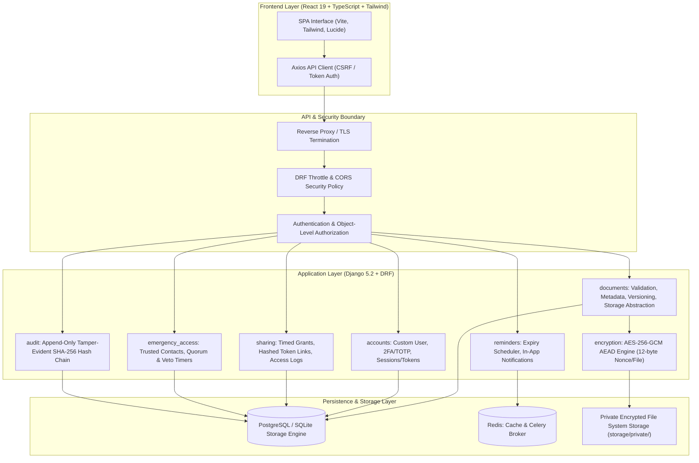

# LifeVault: System Architecture & Design Specification

## 1. System Overview

**LifeVault** is a zero-trust, defense-in-depth digital document and personal records vault engineered to provide secure storage, metadata categorization, version lifecycle management, authenticated encryption, controlled external sharing, and emergency access recovery for personal documents.

---

## 2. Component Responsibilities

| Module | Core Responsibility | Security Invariants |
| :--- | :--- | :--- |
| **`accounts`** | User registration, authentication, TOTP 2FA, password hashing (PBKDF2/Argon2), profile management. | Plaintext passwords never stored. Strict rate limits on login/reset. Account deletion purges all private user assets. |
| **`documents`** | Multi-type file upload validation, MIME signature verification, metadata indexing, version history, soft-deletion & retention trash. | Never trust user-supplied filenames or browser MIME headers. Files stored with non-predictable UUID keys outside webroot. Direct file URLs disabled. |
| **`encryption`** | Application-level file encryption using authenticated AES-256-GCM (`cryptography` library). | Fresh random 96-bit (12-byte) IV/nonce for every encryption operation. Server-side master key separation. Corrupted ciphertexts trigger immediate integrity failure. |
| **`sharing`** | Granular user-to-user sharing and time-bound link tokens. | Link tokens stored as SHA-256 digests in database. Revocation is instantaneous. Configurable download caps and expiry timestamps. |
| **`emergency_access`**| Break-glass recovery mechanism for designated trusted contacts. | Enforces mandatory waiting periods (e.g. 48 hours) with real-time veto notices to vault owner. Bypassing authorization is strictly prohibited. |
| **`reminders`** | Expiry tracking, threshold alarms (30d, 7d, 1d), deduplicated notifications, Celery scheduler. | Idempotent notifications: unique deduplication key prevents duplicate alerts on task retry. Time-zone aware comparisons. |
| **`audit`** | Comprehensive append-only audit trail recording every security-critical mutation. | Application-level chained hash verification (`current_hash = SHA256(prev_hash + serialized_event)`). No secrets logged. Immutable via API. |
| **`api`** | Centralized routing, standardized RFC-7807-style error formatting, health checks, OpenAPI schema generation. | Unified error structure. Leaks zero stack traces or database schema internals in production. |

---

## 3. Technology & Security Decisions

### 3.1 Authenticated Encryption (AES-256-GCM)
- **Decision**: Use Python's audited `cryptography.hazmat.primitives.ciphers.aead.AESGCM` with a 256-bit key.
- **Rationale**: AES-GCM provides both confidentiality and data origin authentication (integrity). Unlike unauthenticated modes (such as AES-CBC without HMAC) which are vulnerable to bit-flipping and padding oracle attacks, AES-GCM detects any unauthorized modification or file corruption.
- **Nonce Discipline**: Every encryption operation generates an independent, cryptographically random 12-byte (96-bit) nonce via `os.urandom(12)`. Nonce reuse under the same key completely breaks GCM security; our implementation guarantees fresh nonce generation per file version.

### 3.2 Private Local Storage Abstraction
- **Decision**: Documents are stored in an isolated filesystem location (`storage/private/`) outside the HTTP document root.
- **Rationale**: Direct file exposure through web server directories (e.g., standard `/media/` serving) bypasses authorization checks. LifeVault implements an abstraction layer (`StorageObject`) where all file retrievals must pass through authenticated Django view controllers verifying object-level ownership before decrypting and streaming the content.

### 3.3 Hashed Share Tokens
- **Decision**: When generating external sharing links, the plaintext token (`secrets.token_urlsafe(32)`) is handed to the client once. The database stores only `SHA-256(token)`.
- **Rationale**: Following modern API secret best practices, even if a database snapshot is leaked, external sharing tokens cannot be reconstructed or exploited.

### 3.4 Tamper-Evident Chained Audit Logging
- **Decision**: Every audit entry computes `SHA-256(prev_hash || timestamp || actor_id || action || target_id)`.
- **Rationale**: Ensures cryptographic sequencing. Modifying or deleting any historical log row breaks the verification chain, alerting administrators to internal tampering.
