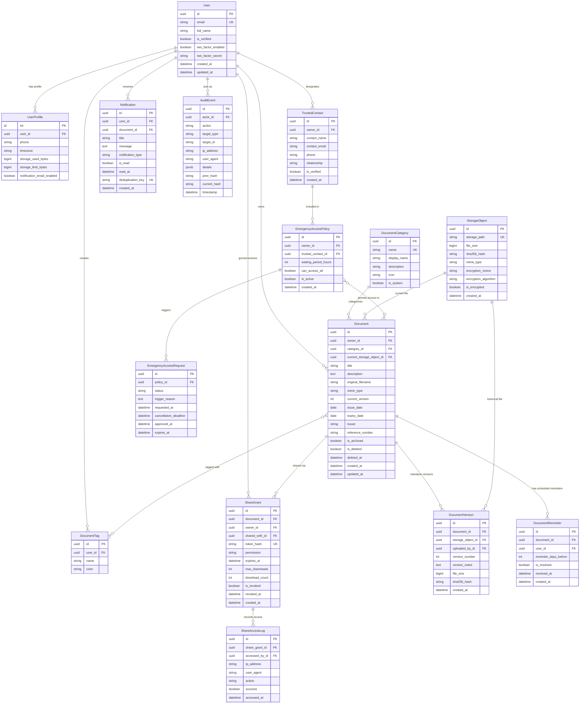

# LifeVault Database Architecture & ER Diagram

## 1. Entity-Relationship Diagram

---

## 2. Key Schema Decisions

1. **UUID Primary Keys for Sensitive Resources**:
   - Primary resources (`User`, `Document`, `DocumentVersion`, `StorageObject`, `ShareGrant`, `AuditEvent`) use version 4 UUIDs rather than sequential auto-incrementing integers.
   - **Security Reason**: Sequential IDs allow enumeration attacks and Insecure Direct Object Reference (IDOR) probing. UUIDs prevent attackers from discovering document volumes or guessing entity identifiers.

2. **StorageObject Abstraction**:
   - Decouples the logical metadata of a `Document` from its physical storage artifact.
   - When a new version is uploaded, a new `StorageObject` is created with its own unique random storage path, encryption nonce, and SHA-256 hash. The `Document` points to the current active `StorageObject`, while all historical versions link to their respective `StorageObjects`.

3. **Soft Deletion with Retention Period**:
   - `Document.is_deleted` and `Document.deleted_at` allow documents to be retained in a "Trash Bin" for a configurable window (e.g., 30 days) before permanent cryptographic shredding.

4. **Chained-Hash Audit Trail**:
   - `AuditEvent` records form a cryptographic Merkle-like chain:
     $$\text{current\_hash} = \text{SHA-256}(\text{prev\_hash} \,||\, \text{timestamp} \,||\, \text{actor\_id} \,||\, \text{action} \,||\, \text{target\_id} \,||\, \text{details})$$
   - This prevents silent row alterations or truncation by malicious actors.
